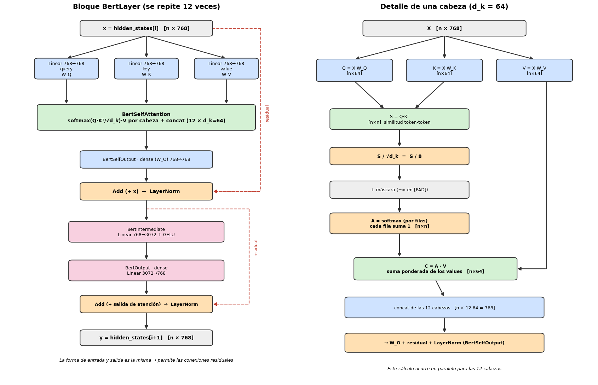
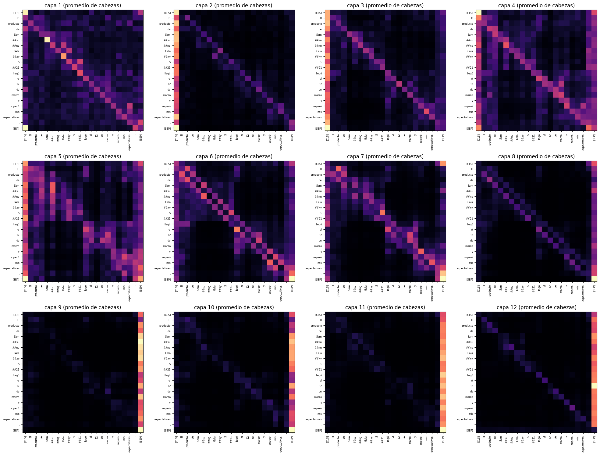
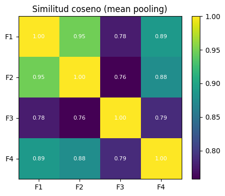

# Unidad 3 – Transformers

**Laboratorio 07 · Inspección de Arquitectura, Hidden States y Autoatención en BERT (BETO)**
Inteligencia Artificial 2026-2 · Escuela Profesional de Ingeniería de Sistemas · UAC

**Estudiantes:**
Auccapiña Bombilla Rodrigo Fabricio - 021200266k
Huillca Monterola Aderly Aldair - 022100363c
Rodrìguez Castro Luz Dioneth – 021201359B
Tapia Palomino Andy Sebastian – 022100575K


[](https://colab.research.google.com/github/SEBASTIAN7844/unidad-3--transformers/blob/main/Lab03_Arquitectura_BERT_BETO.ipynb)

## Objetivo

Explorar la configuración interna de un modelo Transformer preentrenado en español, [`dccuchile/bert-base-spanish-wwm-cased`](https://huggingface.co/dccuchile/bert-base-spanish-wwm-cased) (BETO), analizar sus bloques codificadores, extraer sus *hidden states* y vincular el flujo de tensores con el mecanismo de **Self-Attention**.

## Contenido del repositorio

| Archivo | Descripción |
|---|---|
| `Lab03_Arquitectura_BERT_BETO.ipynb` | Notebook ejecutado con código, salidas y análisis en celdas Markdown. |
| `imagenes/` | Figuras generadas por el notebook, usadas en este README. |
| `README.md` | Este documento. |

## Estructura del notebook

| Sección | Contenido |
|---|---|
| 0 | Preparación del entorno (versiones, GPU, semilla). |
| 1 | Configuración y arquitectura de BERT: `embeddings`, `encoder` (12 `BertLayer`) y `pooler`; conteo de parámetros y verificación de dimensiones Q, K, V. |
| 2 | Tokenización, `input_ids`, `token_type_ids`, `attention_mask`, `hidden_states` y su evolución capa a capa. |
| 3 | Pseudocódigo de Self-Attention, diagrama conceptual, implementación propia verificada contra las 12 capas de BETO y visualización de los pesos de atención. |
| Extra | Similitud entre oraciones, *fill-mask* y checklist automático de verificación. |

Las celdas marcadas como **Extra** van más allá de la guía: comprueban con código cada afirmación de los análisis.

## Modelo

| Parámetro | Valor |
|---|---|
| Capas del encoder (`num_hidden_layers`) | 12 |
| Dimensión oculta (`hidden_size` = d_model) | 768 |
| Cabezas de atención | 12 (d_k = 64) |
| Dimensión de la capa feed-forward | 3072 |
| Vocabulario | 31 002 |
| Parámetros totales | ≈ 109.9 M |

Reparto de parámetros: `embeddings` 22.04 %, `encoder` 77.43 %, `pooler` 0.54 %.

## Resultados principales

- La oración de prueba *"El producto de Samsung Galaxy S21 llegó el 12 de marzo y superó mis expectativas."* se tokeniza en **22 tokens** (`[CLS]` + 20 + `[SEP]`). *Samsung*, *Galaxy* y *S21* se dividen en subpalabras (`Sam ##su ##ng`, `Gala ##xy`, `S ##21`).
- `len(hidden_states) = 13`: la posición 0 es la salida de `embeddings` y las posiciones 1–12 son las salidas de los 12 bloques del encoder.
- `hidden_states[0].shape = [1, 22, 768]`, es decir `[batch_size, sequence_length, hidden_size]`. La forma se conserva en las 13 salidas, lo que permite las conexiones residuales.
- `attention_mask` solo contiene unos y `token_type_ids` solo ceros, porque se procesa una única oración sin *padding*.
- La implementación propia de Self-Attention + Add&Norm + FFN **reproduce numéricamente las 12 capas de BETO**, y cada fila de atención suma 1.
- El checklist automático pasa **11 / 11** verificaciones.

## Diagrama conceptual

Izquierda: bloque `BertLayer` con sus dos conexiones residuales. Derecha: cálculo de una cabeza de atención con las formas de los tensores.



Fórmula implementada:

```
Attention(Q, K, V) = softmax(Q·Kᵀ / √d_k) · V
```

## Visualización de la atención

Atención promedio de las 12 cabezas en cada capa. Las capas iniciales muestran un patrón diagonal (cada token atiende a sí mismo y a sus vecinos, con peso también en `[CLS]`), y desde la capa 9 la atención se concentra en `[SEP]`.



## Extras

**Similitud entre oraciones** (*mean pooling* de la última capa, similitud coseno): las dos oraciones sobre un celular recién llegado (F1 y F2) son las más parecidas (0.95); la oración sobre fútbol (F3) es la más distinta (0.76–0.79) y la oración de Samsung (F4) queda cerca de F1 y F2 (0.88–0.89).



**Fill-mask** con `BertForMaskedLM`: para *"Lima es la [MASK] del Perú."* el modelo predice *capital* con 98.7 %.

## Cómo ejecutarlo

1. Abre el notebook con el botón **Open in Colab**.
2. (Opcional) Activa la GPU en **Entorno de ejecución > Cambiar tipo de entorno de ejecución > GPU T4**. También corre en CPU, solo más lento.
3. Ejecuta todo en orden con **Entorno de ejecución > Ejecutar todo** (Ctrl+F9).

La primera ejecución descarga unos 440 MB del modelo desde Hugging Face. Los avisos sobre peticiones sin autenticar son normales.

## Referencias

- Devlin et al., *BERT: Pre-training of Deep Bidirectional Transformers for Language Understanding* (2018).
- Vaswani et al., *Attention Is All You Need* (2017).
- Cañete et al., *Spanish Pre-Trained BERT Model and Evaluation Data* (2020).
